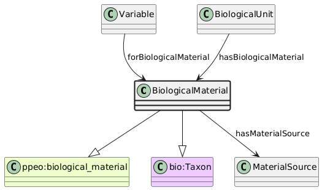

# BiologicalMaterial
[https://schema.plantphenomics.org.au/BiologicalMaterial](https://schema.plantphenomics.org.au/BiologicalMaterial)

A taxonomic and/or genetic profile for one or more BiologicalUnits. Where possible, this should include the material source for the BiologicalMaterial.

## Superclasses
* http://purl.org/ppeo/PPEO.owl#biological_material
* https://bioschemas.org/terms/Taxon
## Properties
* [appn:Variable](appn_Variable.md) **appn:forBiologicalMaterial** appn:BiologicalMaterial
    * Links a Variable to the BiologicalMaterial (i.e. crop) to which it relates.
* [appn:BiologicalUnit](appn_BiologicalUnit.md) **appn:hasBiologicalMaterial** appn:BiologicalMaterial
    * Identifies the BiologicalMaterial for a BiologicalUnit.
* appn:BiologicalMaterial **appn:hasHigherTaxon** [appn:BiologicalMaterial](appn_BiologicalMaterial.md)
    * Identifies a more inclusive BiologicalMaterial as a higher taxon.
* appn:BiologicalMaterial **appn:hasMaterialSource** [appn:MaterialSource](appn_MaterialSource.md)
    * Identifies the MaterialSource for BiologicalMaterial.
* appn:BiologicalMaterial **appn:order** [xsd:string](http://www.w3.org/2001/XMLSchema#string)
    * A taxonomic rank above family and below class
* appn:BiologicalMaterial **appn:family** [xsd:string](http://www.w3.org/2001/XMLSchema#string)
    * A taxonomic rank above genus and below order
* appn:BiologicalMaterial **appn:genus** [xsd:string](http://www.w3.org/2001/XMLSchema#string)
    * A taxonomic rank above species and below family
* appn:BiologicalMaterial **appn:specificEpithet** [xsd:string](http://www.w3.org/2001/XMLSchema#string)
    * The specific epithet of a binomial or trinomial scientific name
* appn:BiologicalMaterial **appn:infraspecificEpithet** [xsd:string](http://www.w3.org/2001/XMLSchema#string)
    * The infraspecific epithet of a trinomial scientific name
* appn:BiologicalMaterial **appn:cultivarEpithet** [xsd:string](http://www.w3.org/2001/XMLSchema#string)
    * A name for a cultivar or breed.
* appn:BiologicalMaterial **appn:uninomial** [xsd:string](http://www.w3.org/2001/XMLSchema#string)
    * A scientific name comprising a single word (genus or higher)
* appn:BiologicalMaterial **appn:scientificName** [xsd:string](http://www.w3.org/2001/XMLSchema#string)
    * A name for an organism subject to one of the codes of nomenclature
* appn:BiologicalMaterial **appn:rank** [xsd:string](http://www.w3.org/2001/XMLSchema#string)
    * The rank of a scientific name
* appn:BiologicalMaterial **appn:rank** [xsd:anyURI](http://www.w3.org/2001/XMLSchema#anyURI)
    * The rank of a scientific name
* appn:BiologicalMaterial **appn:taxonID** [xsd:string](http://www.w3.org/2001/XMLSchema#string)
    * An identifier for a taxon
* appn:BiologicalMaterial **appn:taxonID** [xsd:anyURI](http://www.w3.org/2001/XMLSchema#anyURI)
    * An identifier for a taxon
* appn:BiologicalMaterial **appn:hasPreprocessing** [xsd:string](http://www.w3.org/2001/XMLSchema#string)
    * Description of any preprocessing carried out on the biological material
* appn:BiologicalMaterial **appn:geneticallyModifiedStatus** [xsd:boolean](http://www.w3.org/2001/XMLSchema#boolean)
    * True if biological material is genetically modified
* appn:BiologicalMaterial **appn:quarantineStatus** [xsd:boolean](http://www.w3.org/2001/XMLSchema#boolean)
    * True if biological material requires quarantine
* appn:BiologicalMaterial **appn:hasCountryOfOrigin** [appn:Country](appn_Country.md)
    * Country from which BiologicalMaterial originated
