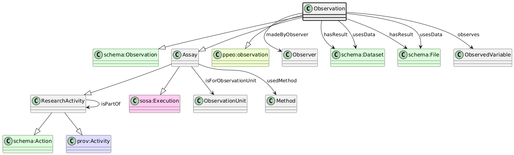

# Observation
[https://schema.plantphenomics.org.au/Observation](https://schema.plantphenomics.org.au/Observation)

An Assay that observes or measures properties of an ObservationUnit returning results as property values or images.

## Superclasses
* http://schema.org/Observation
* [https://schema.plantphenomics.org.au/Assay](appn_Assay.md)
* [https://schema.plantphenomics.org.au/ResearchActivity](appn_ResearchActivity.md)
* http://schema.org/Action
* http://www.w3.org/ns/prov#Activity
* http://www.w3.org/ns/sosa/Observation
* http://purl.org/ppeo/PPEO.owl#observation
## Properties
* appn:Observation **appn:madeByObserver** [appn:Observer](appn_Observer.md)
    * Identifies the entity (Observer, i.e. one of a Person, Sensor or SoftwareApplication) responsible for carrying out an Observation.
* appn:Observation **appn:hasResult** [appn:File](appn_File.md)
    * Identifies a data output from an Observation or Control assay. Individual values are represented by appn:hasSimpleResult.
* appn:Observation **appn:hasSimpleResult** [xsd:string](http://www.w3.org/2001/XMLSchema#string)
    * Identifies a discrete value received as a data output from an Observation or Control assay.
* appn:Observation **appn:hasSimpleResult** [xsd:integer](http://www.w3.org/2001/XMLSchema#integer)
    * Identifies a discrete value received as a data output from an Observation or Control assay.
* appn:Observation **appn:hasSimpleResult** [xsd:float](http://www.w3.org/2001/XMLSchema#float)
    * Identifies a discrete value received as a data output from an Observation or Control assay.
* appn:Observation **appn:hasSimpleResult** [xsd:double](http://www.w3.org/2001/XMLSchema#double)
    * Identifies a discrete value received as a data output from an Observation or Control assay.
* appn:Observation **appn:hasSimpleResult** [xsd:boolean](http://www.w3.org/2001/XMLSchema#boolean)
    * Identifies a discrete value received as a data output from an Observation or Control assay.
* appn:Observation **appn:usesData** [appn:File](appn_File.md)
    * Identifies a data input to an Observation assay. This is intended for use in relation to Observations delivered using a SoftwareApplication.
* appn:Observation **appn:observes** [appn:ObservedVariable](appn_ObservedVariable.md)
    * Identifies an ObservedVariable controlled by an Observation assay. The Observation records or estimates the state of the ObservationVariable recorded as a value specified in a hasResult or hasSimpleResult property.
* [appn:Assay](appn_Assay.md) **appn:isForObservationUnit** [appn:ObservationUnit](appn_ObservationUnit.md)
    * Relates an Assay to an ObservationUnit for which it is carried out. Note that when the Assay is an Observation, the model should infer a schema:observationAbout property from isForObservationUnit.
* [appn:Assay](appn_Assay.md) **appn:usedMethod** [appn:Method](appn_Method.md)
    * Identifies a Method used to conduct an Assay or to derive values for a Variable.
* [appn:ResearchActivity](appn_ResearchActivity.md) **appn:isPartOf** [appn:ResearchActivity](appn_ResearchActivity.md)
    * Relates an Assay to the Study that includes it or a Study to an Investigation.
* [appn:Role](appn_Role.md) **appn:isRoleOfPersonIn** [appn:ResearchActivity](appn_ResearchActivity.md)
    * Indicates a ResearchActivity in which a Person has a Role
* [appn:ResearchActivity](appn_ResearchActivity.md) **appn:startTime** [xsd:dateTime](http://www.w3.org/2001/XMLSchema#dateTime)
    * The time at which a ResearchActivity started
* [appn:ResearchActivity](appn_ResearchActivity.md) **appn:endTime** [xsd:dateTime](http://www.w3.org/2001/XMLSchema#dateTime)
    * The time at which a ResearchActivity ended
* [appn:ResearchActivity](appn_ResearchActivity.md) **appn:atTime** [xsd:dateTime](http://www.w3.org/2001/XMLSchema#dateTime)
    * The time at which a ResearchActivity occurred - equivalent to both startTime and endTime
