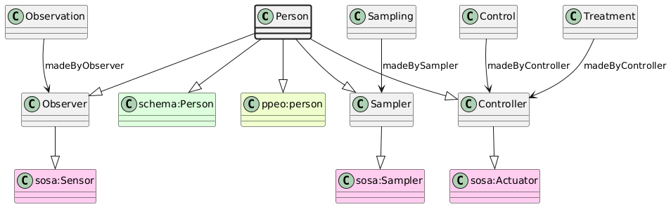

# Person
[https://schema.plantphenomics.org.au/Person](https://schema.plantphenomics.org.au/Person)

A person, preferably identified using an ORCID, that may perform an Assay.

## Superclasses
* http://purl.org/ppeo/PPEO.owl#person
* [https://schema.plantphenomics.org.au/Observer](appn_Observer.md)
* http://www.w3.org/ns/sosa/Sensor
* [https://schema.plantphenomics.org.au/Controller](appn_Controller.md)
* http://www.w3.org/ns/sosa/Actuator
* [https://schema.plantphenomics.org.au/Sampler](appn_Sampler.md)
* http://www.w3.org/ns/sosa/Sampler
* http://schema.org/Person
## Properties
* appn:Person **appn:hasRole** [appn:Role](appn_Role.md)
    * Indicates a role for a Person or Organization in a ResearchActivity
* appn:Person **appn:affiliation** [appn:Organisation](appn_Organisation.md)
    * Associates a Person with an Organization with which they are affiliated.
* [appn:Grant](appn_Grant.md) **appn:fundedPerson** appn:Person
    * Associates a recipient Person with a Grant.
* appn:Person **appn:orcid** [xsd:anyURI](http://www.w3.org/2001/XMLSchema#anyURI)
    * The ORCID for a Person.

The ORCID for a Person.
* appn:Person **appn:restrictedPII** [xsd:boolean](http://www.w3.org/2001/XMLSchema#boolean)
    * Indicates whether personally identifiable information is restricted for a Person.
* [appn:Observation](appn_Observation.md) **appn:madeByObserver** [appn:Observer](appn_Observer.md)
    * Identifies the entity (Observer, i.e. one of a Person, Sensor or SoftwareApplication) responsible for carrying out an Observation.
* [appn:Control](appn_Control.md) **appn:madeByController** [appn:Controller](appn_Controller.md)
    * Identifies the entity (Controller, i.e. one of a Person, Actuator, SoftwareApplication or ExternalEvent) responsible for carrying out a Control or Treatment.
* [appn:Treatment](appn_Treatment.md) **appn:madeByController** [appn:Controller](appn_Controller.md)
    * Identifies the entity (Controller, i.e. one of a Person, Actuator, SoftwareApplication or ExternalEvent) responsible for carrying out a Control or Treatment.
* [appn:Sampling](appn_Sampling.md) **appn:madeBySampler** [appn:Sampler](appn_Sampler.md)
    * Identifies the entity (Sampler, i.e. a Person - no other subclasses defined yet) responsible for carrying out an Sampling.
