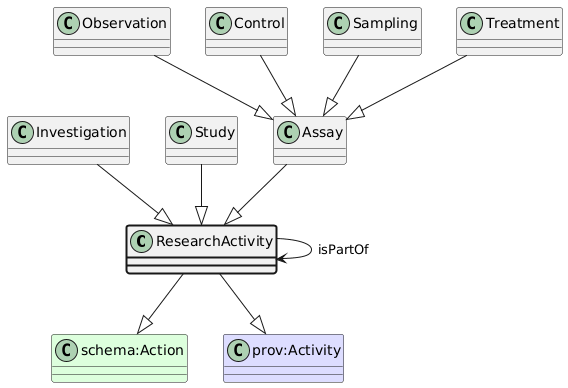

# ResearchActivity
[https://schema.plantphenomics.org.au/ResearchActivity](https://schema.plantphenomics.org.au/ResearchActivity)

A time-delimited activity contributing to a research goal.

## Superclasses
* http://schema.org/Action
* http://www.w3.org/ns/prov#Activity
## Properties
* appn:ResearchActivity **appn:isPartOf** [appn:ResearchActivity](appn_ResearchActivity.md)
    * Relates an Assay to the Study that includes it or a Study to an Investigation.
* [appn:Role](appn_Role.md) **appn:isRoleOfPersonIn** appn:ResearchActivity
    * Indicates a ResearchActivity in which a Person has a Role
* appn:ResearchActivity **appn:startTime** [xsd:dateTime](http://www.w3.org/2001/XMLSchema#dateTime)
    * The time at which a ResearchActivity started
* appn:ResearchActivity **appn:endTime** [xsd:dateTime](http://www.w3.org/2001/XMLSchema#dateTime)
    * The time at which a ResearchActivity ended
* appn:ResearchActivity **appn:atTime** [xsd:dateTime](http://www.w3.org/2001/XMLSchema#dateTime)
    * The time at which a ResearchActivity occurred - equivalent to both startTime and endTime
## Subclasses
* [https://schema.plantphenomics.org.au/Investigation](appn_Investigation.md)
* [https://schema.plantphenomics.org.au/Study](appn_Study.md)
* [https://schema.plantphenomics.org.au/Assay](appn_Assay.md)
* [https://schema.plantphenomics.org.au/Observation](appn_Observation.md)
* [https://schema.plantphenomics.org.au/Control](appn_Control.md)
* [https://schema.plantphenomics.org.au/Sampling](appn_Sampling.md)
* [https://schema.plantphenomics.org.au/Treatment](appn_Treatment.md)
