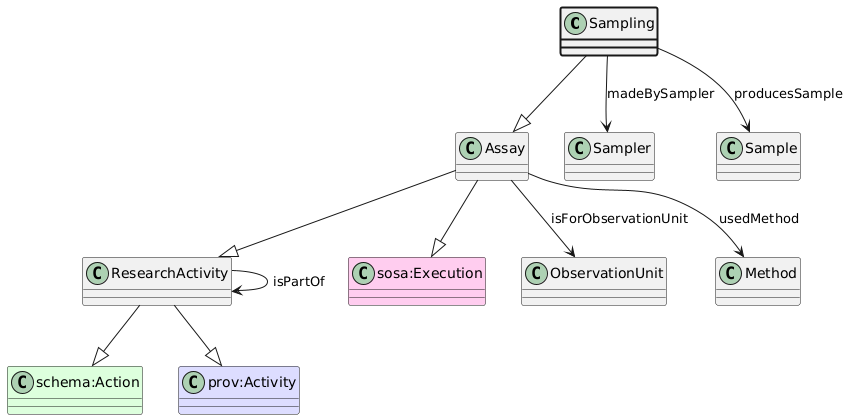

# Sampling
[https://schema.plantphenomics.org.au/Sampling](https://schema.plantphenomics.org.au/Sampling)

An Assay that derives a new representative ObservationUnit from an existing ObservationUnit.

## Superclasses
* http://www.w3.org/ns/sosa/Sampling
* [https://schema.plantphenomics.org.au/Assay](appn_Assay.md)
* [https://schema.plantphenomics.org.au/ResearchActivity](appn_ResearchActivity.md)
* http://schema.org/Action
* http://www.w3.org/ns/prov#Activity
## Properties
* appn:Sampling **appn:madeBySampler** [appn:Sampler](appn_Sampler.md)
    * Identifies the entity (Sampler, i.e. a Person - no other subclasses defined yet) responsible for carrying out an Sampling.
* appn:Sampling **appn:producesSample** [appn:Sample](appn_Sample.md)
    * Identifies the Sample produced by a Sampling assay.
* [appn:Assay](appn_Assay.md) **appn:isForObservationUnit** [appn:ObservationUnit](appn_ObservationUnit.md)
    * Relates an Assay to an ObservationUnit for which it is carried out. Note that when the Assay is an Observation, the model should infer a schema:observationAbout property from isForObservationUnit.
* [appn:Assay](appn_Assay.md) **appn:usedMethod** [appn:Method](appn_Method.md)
    * Identifies a Method used to conduct an Assay or to derive values for a Variable.
* [appn:ResearchActivity](appn_ResearchActivity.md) **appn:isPartOf** [appn:ResearchActivity](appn_ResearchActivity.md)
    * Relates an Assay to the Study that includes it or a Study to an Investigation.
* [appn:Role](appn_Role.md) **appn:isRoleOfPersonIn** [appn:ResearchActivity](appn_ResearchActivity.md)
    * Indicates a ResearchActivity in which a Person has a Role
* [appn:ResearchActivity](appn_ResearchActivity.md) **appn:startTime** [xsd:dateTime](http://www.w3.org/2001/XMLSchema#dateTime)
    * The time at which a ResearchActivity started
* [appn:ResearchActivity](appn_ResearchActivity.md) **appn:endTime** [xsd:dateTime](http://www.w3.org/2001/XMLSchema#dateTime)
    * The time at which a ResearchActivity ended
* [appn:ResearchActivity](appn_ResearchActivity.md) **appn:atTime** [xsd:dateTime](http://www.w3.org/2001/XMLSchema#dateTime)
    * The time at which a ResearchActivity occurred - equivalent to both startTime and endTime
