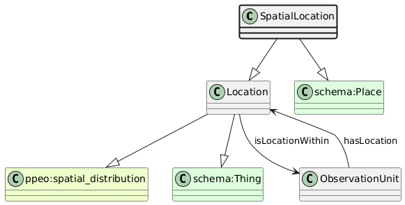

# SpatialLocation
[https://schema.plantphenomics.org.au/SpatialLocation](https://schema.plantphenomics.org.au/SpatialLocation)

A location defined with geospatial coordinates.

## Superclasses
* [https://schema.plantphenomics.org.au/Location](appn_Location.md)
* http://purl.org/ppeo/PPEO.owl#spatial_distribution
* http://schema.org/Thing
* http://purl.org/ppeo/PPEO.owl#GPS_location
* http://schema.org/Place
## Properties
* SpatialLocation https://schema.plantphenomics.org.au/hasLatitude
* SpatialLocation https://schema.plantphenomics.org.au/hasLongitude
* SpatialLocation https://schema.plantphenomics.org.au/hasUncertainty
* SpatialLocation https://schema.plantphenomics.org.au/hasAltitude
* appn:SpatialLocation **appn:hasCountry** [appn:Country](appn_Country.md)
    * Country for a SpatialLocation
* [appn:ObservationUnit](appn_ObservationUnit.md) **appn:hasLocation** [appn:Location](appn_Location.md)
    * Specifies the location for an ObservationUnit.
* [appn:Location](appn_Location.md) **appn:isLocationWithin** [appn:ObservationUnit](appn_ObservationUnit.md)
    * Specifies that a location is a position within an ObservationUnit.
