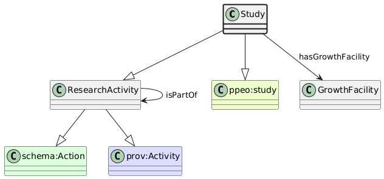

# Study
[https://schema.plantphenomics.org.au/Study](https://schema.plantphenomics.org.au/Study)

A research activity including one or more Assays that record data on a set of ObservationUnits.

## Superclasses
* [https://schema.plantphenomics.org.au/ResearchActivity](appn_ResearchActivity.md)
* http://schema.org/Action
* http://www.w3.org/ns/prov#Activity
* http://purl.org/ppeo/PPEO.owl#study
## Properties
* appn:Study **appn:hasGrowthFacility** [appn:GrowthFacility](appn_GrowthFacility.md)
    * Identifies a GrowthFacility used in a Study.
* [appn:ResearchActivity](appn_ResearchActivity.md) **appn:isPartOf** [appn:ResearchActivity](appn_ResearchActivity.md)
    * Relates an Assay to the Study that includes it or a Study to an Investigation.
* [appn:Role](appn_Role.md) **appn:isRoleOfPersonIn** [appn:ResearchActivity](appn_ResearchActivity.md)
    * Indicates a ResearchActivity in which a Person has a Role
* [appn:ResearchActivity](appn_ResearchActivity.md) **appn:startTime** [xsd:dateTime](http://www.w3.org/2001/XMLSchema#dateTime)
    * The time at which a ResearchActivity started
* [appn:ResearchActivity](appn_ResearchActivity.md) **appn:endTime** [xsd:dateTime](http://www.w3.org/2001/XMLSchema#dateTime)
    * The time at which a ResearchActivity ended
* [appn:ResearchActivity](appn_ResearchActivity.md) **appn:atTime** [xsd:dateTime](http://www.w3.org/2001/XMLSchema#dateTime)
    * The time at which a ResearchActivity occurred - equivalent to both startTime and endTime
