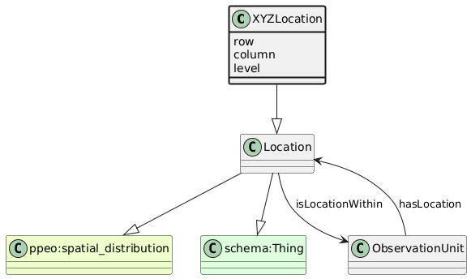

# XYZLocation
[https://schema.plantphenomics.org.au/XYZLocation](https://schema.plantphenomics.org.au/XYZLocation)

A location defined using an appropriate local spatial geometry in three dimensions.

## Superclasses
* [https://schema.plantphenomics.org.au/Location](appn_Location.md)
* http://purl.org/ppeo/PPEO.owl#spatial_distribution
* http://schema.org/Thing
## Properties
* appn:XYZLocation **appn:row** [xsd:string](http://www.w3.org/2001/XMLSchema#string)
    * Specifies the row for an XYZLocation.
* appn:XYZLocation **appn:row** [xsd:integer](http://www.w3.org/2001/XMLSchema#integer)
    * Specifies the row for an XYZLocation.
* appn:XYZLocation **appn:row** [xsd:float](http://www.w3.org/2001/XMLSchema#float)
    * Specifies the row for an XYZLocation.
* appn:XYZLocation **appn:row** [xsd:double](http://www.w3.org/2001/XMLSchema#double)
    * Specifies the row for an XYZLocation.
* appn:XYZLocation **appn:column** [xsd:string](http://www.w3.org/2001/XMLSchema#string)
    * Specifies the column for an XYZLocation.
* appn:XYZLocation **appn:column** [xsd:integer](http://www.w3.org/2001/XMLSchema#integer)
    * Specifies the column for an XYZLocation.
* appn:XYZLocation **appn:column** [xsd:float](http://www.w3.org/2001/XMLSchema#float)
    * Specifies the column for an XYZLocation.
* appn:XYZLocation **appn:column** [xsd:double](http://www.w3.org/2001/XMLSchema#double)
    * Specifies the column for an XYZLocation.
* appn:XYZLocation **appn:level** [xsd:string](http://www.w3.org/2001/XMLSchema#string)
    * Specifies the level for an XYZLocation in a three-dimensional configuration.
* appn:XYZLocation **appn:level** [xsd:integer](http://www.w3.org/2001/XMLSchema#integer)
    * Specifies the level for an XYZLocation in a three-dimensional configuration.
* appn:XYZLocation **appn:level** [xsd:float](http://www.w3.org/2001/XMLSchema#float)
    * Specifies the level for an XYZLocation in a three-dimensional configuration.
* appn:XYZLocation **appn:level** [xsd:double](http://www.w3.org/2001/XMLSchema#double)
    * Specifies the level for an XYZLocation in a three-dimensional configuration.
* [appn:ObservationUnit](appn_ObservationUnit.md) **appn:hasLocation** [appn:Location](appn_Location.md)
    * Specifies the location for an ObservationUnit.
* [appn:Location](appn_Location.md) **appn:isLocationWithin** [appn:ObservationUnit](appn_ObservationUnit.md)
    * Specifies that a location is a position within an ObservationUnit.
